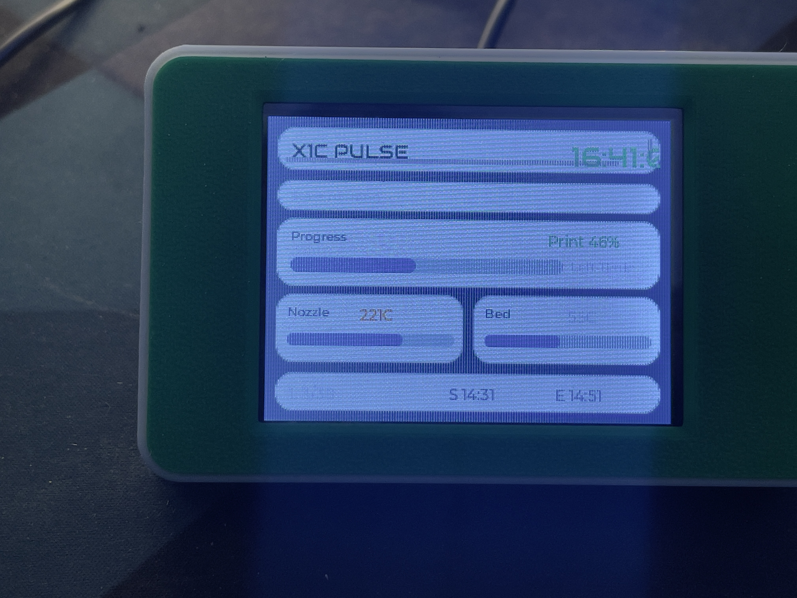

# CYD Dashboard — cyd-3dprinter-HA-integration

> A feature-rich ESPHome dashboard for the **Cheap Yellow Display (CYD)** that monitors your 3D printer in real time through Home Assistant.


---

## ✨ Features

- 🎨 **8 themes** — Tactical, Monitor, Orbit, Blueprint, Brutal, Apple, Modern Grid, Skeuomorphic
- 🖌️ **8 color palettes** — independently selectable from themes, synced to Home Assistant
- 👆 **Swipe gestures** — left/right to cycle through themes and palettes
- 📊 **Live printer data** — progress, nozzle & bed temps, layer, time remaining, start/end time
- 🔔 **Toast notifications** — visual feedback on theme/palette changes
- 📱 **Quick panel** — overlay for settings and quick actions
- 💡 **Boot loading screen** — step-by-step startup status (WiFi, HA, UI)
- 💾 **Persistent settings** — theme and palette survive reboots
- 😴 **Auto-sleep** — backlight dims after inactivity
- 🔗 **HA sync** — theme/palette exposed as entities for automation

---

## 📸 Preview

| Orbit | Tactical | Blueprint |
|-------|----------|-----------|
|  |  |  |

| Monitor | Brutal | Apple |
|---------|--------|-------|
|  |  |  |

| Modern Grid | Skeuomorphic |
|-------------|--------------|
|  |  |

> Note that some of the themes are not finished.

---

## ⚡ Quick Start — no clone required

You can use this dashboard **without cloning the repository**. ESPHome will download the dashboard automatically from GitHub.

### 1 — Create your device config

In ESPHome Builder, create a blank config, copy the example below, and fill in your printer entities:

```yaml
# ─────────────────────────────────────────────────────────────────────────────
# CYD 3D Printer Dashboard — User configuration file
# Copy this file, rename it, and fill in your own values.
#
# No clone needed — the full dashboard is loaded from GitHub automatically.
# Source: https://github.com/maelremrem/cyd-3dprinter-HA-integration
# ─────────────────────────────────────────────────────────────────────────────

substitutions:
  device_name: cyd-3d-dashboard       # ESPHome device name (no spaces)
  friendly_name: CYD 3D Dashboard     # Displayed in Home Assistant
  short_name: X1C                     # Short label shown on the display

  # ── API / OTA / Wi-Fi credentials ─────────────────────────────────────────
  # Leave these as !secret and define them in secrets.yaml.
  # Generate ha_api_key from ESPHome's API encryption key helper.
  ha_api_key: !secret ha_api_key
  ota_password: !secret ota_password
  wifi_ssid: !secret wifi_ssid
  wifi_password: !secret wifi_password

  # ── Home Assistant printer entities ────────────────────────────────────────
  # Replace each value with your own entity IDs from the Bambu Lab integration
  # (or any other printer integration exposing similar sensors)
  printer_progress_entity: sensor.YOUR_PRINTER_print_progress
  printer_nozzle_entity: sensor.YOUR_PRINTER_nozzle_temperature
  printer_bed_entity: sensor.YOUR_PRINTER_bed_temperature
  printer_time_entity: sensor.YOUR_PRINTER_remaining_time
  printer_layer_entity: sensor.YOUR_PRINTER_current_layer
  printer_total_layer_entity: sensor.YOUR_PRINTER_total_layer_count
  printer_state_entity: sensor.YOUR_PRINTER_print_status
  printer_start_time_entity: sensor.YOUR_PRINTER_start_time
  printer_end_time_entity: sensor.YOUR_PRINTER_end_time
  printer_power_entity: sensor.YOUR_PRINTER_power
  quick_action_title: "Turn on printer"
  quick_action_entity: switch.YOUR_PRINTER_switch

  ha_clock_entity: sensor.time        # Standard HA time sensor (HH:MM)


# ─────────────────────────────────────────────────────────────────────────────
# Remote package — downloads the full dashboard firmware from GitHub.
# ESPHome caches it locally and refreshes once per day.
# ─────────────────────────────────────────────────────────────────────────────
packages:
  pins: github://maelremrem/cyd-3dprinter-HA-integration/packages/cyd-dashboard-pins.yaml@main
  colors: github://maelremrem/cyd-3dprinter-HA-integration/packages/cyd-dashboard-colors.yaml@main
  dashboard: github://maelremrem/cyd-3dprinter-HA-integration/packages/cyd-dashboard.yaml@main
```

### 2 — Flash

```bash
esphome run my-x1c.yaml
```
You can also flash directly from ESPHome Builder in Home Assistant.

Using a USB cable is recommended for the first flash.

That's it. No local files beyond your config and secrets needed. ESPHome fetches the dashboard code and all defaults from GitHub, caches it locally, and refreshes once per day.

---

### 3 — Usage

There are 3 controls on the touch screen:
- **Swipe right-to-left** → next theme  
- **Swipe left-to-right** → next palette
- **Swipe down-to-up** → quick menu

You need to allow the ESPHome device to perform Home Assistant actions. See the [Home Assistant ESPHome actions guide](https://www.home-assistant.io/integrations/esphome#allow-the-device-to-perform-home-assistant-actions).

The quick menu can call `homeassistant.toggle` for `quick_action_entity`, so it works best with on/off entities such as `switch.*`.

Quick menu details:


## 🛒 Hardware

| Component | Details |
|-----------|---------|
| **ESP32 board** | CYD (Cheap Yellow Display) — ESP32 + ILI9341 + XPT2046 |
| **Display** | ILI9341 320×240 px TFT, SPI |
| **Touch** | XPT2046 resistive touchscreen |
| **RGB LED** | Built-in on CYD |

> The default configuration targets the **ILI9341-based ESP32-2432S028 / ESP32-2432S028R** with the standard pinout. CYD revisions with ST7789V or ILI9342 controllers need a matching driver/model and possibly different display settings; they are not covered by this default.

---

## 🧰 Prerequisites

- [ESPHome](https://esphome.io) ≥ 2025.2.0 (CLI or Home Assistant add-on)
- [Home Assistant](https://www.home-assistant.io) with the **Bambu Lab integration** installed
- A **Bambu Lab X1C**, or another printer integration exposing similar sensors. This project was tested with [ha-bambulab](https://github.com/greghesp/ha-bambulab).

---

## 🎨 Themes & Palettes

Themes and palettes are **independent** — you can mix any theme with any palette.

| # | Theme / Palette |
|---|----------------|
| 1 | Tactical |
| 2 | Monitor |
| 3 | Orbit |
| 4 | Blueprint |
| 5 | Brutal |
| 6 | Apple |
| 7 | Modern Grid |
| 8 | Skeuomorphic |

Both are exposed as `select` entities in Home Assistant (`CYD X1C Dashboard Theme` / `Palette`) and persist across reboots.

You can create your own colors with ESPHome substitutions. If you override the palette values locally, remove or comment out the remote `colors` package.

---

## ✅ Validate Before Flashing

Before flashing, you can check that ESPHome can load the remote packages and substitutions:

```bash
esphome config my-x1c.yaml
```

Make sure your `secrets.yaml` contains `ha_api_key`, `ota_password`, `wifi_ssid`, and `wifi_password`.

---

## 🤝 Home Assistant Integration

After flashing, the device will appear automatically in Home Assistant (ESPHome integration). Exposed entities include:

| Entity | Type | Description |
|--------|------|-------------|
| `select.cyd_x1c_dashboard_theme` | Select | Current UI theme |
| `select.cyd_x1c_dashboard_palette` | Select | Current color palette |
| `sensor.cyd_x1c_dashboard_wifi_signal` | Sensor | WiFi RSSI |
| `switch.cyd_x1c_dashboard_backlight` | Switch | Display on/off |

---

## 3D Printing

I have used [this model](https://makerworld.com/en/models/2787810-cyd-desk-buddy-for-bambu-lab-home-assistant)

---

## 🖥️ Display compatibility (ESPHome 2026.6+)

The dashboard uses the `ili9xxx` display driver by default on the ILI9341 CYD. Some ESP32-2432S028R boards show horizontal streaking or a scrambled screen with `mipi_spi` even though the factory firmware works. The legacy driver has been confirmed working on affected hardware by a user in [issue #9](https://github.com/maelremrem/cyd-3dprinter-HA-integration/issues/9).

No changes to the printer entities, themes, or touch pin substitutions are required. After upgrading, **recompile and flash** the firmware (the remote GitHub package may be cached).

**Important:** ESPHome has deprecated `ili9xxx` and announced its removal in **2027.5.0**. This is a compatibility workaround, not a permanent upstream solution. The project will need to migrate back to `mipi_spi` once its CYD behavior is verified.

If you use a different CYD controller (e.g. ST7789V or ILI9342), do not blindly flash the default ILI9341 configuration; identify the actual display model first.

---

## 🔧 Troubleshooting

| Symptom | Fix |
|---------|-----|
| Horizontal streaks or scrambled screen on an ILI9341 CYD | Recompile with the latest package using `ili9xxx`; verify the hardware model and try USB flashing if OTA keeps the old firmware |
| ESPHome `Invalid offsets` for `display.mipi_spi` | Recompile with the updated package, which uses `ili9xxx`. Custom `mipi_spi` configurations must provide consistent dimensions and offsets |
| Deprecated `ili9xxx` warning | Expected on ESPHome 2026.x; see the planned 2027.5.0 removal above |
| Touch is off / inverted | Adjust `touch_cal_*` and `touch_swap_xy` / `touch_mirror_*` substitutions |
| Display is mirrored | Set `display_mirror_x` or `display_mirror_y` to `"true"` |
| No printer data | Check the `printer_*_entity` substitutions in your ESPHome config match your HA integration |
| Theme not restored after reboot | ESPHome saves theme index to NVS — first reboot after flash resets to default |
| WiFi fallback AP active | Connect to the `CYD-<short_name>-Fallback` access point and update your Wi-Fi credentials |
